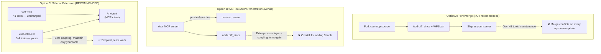
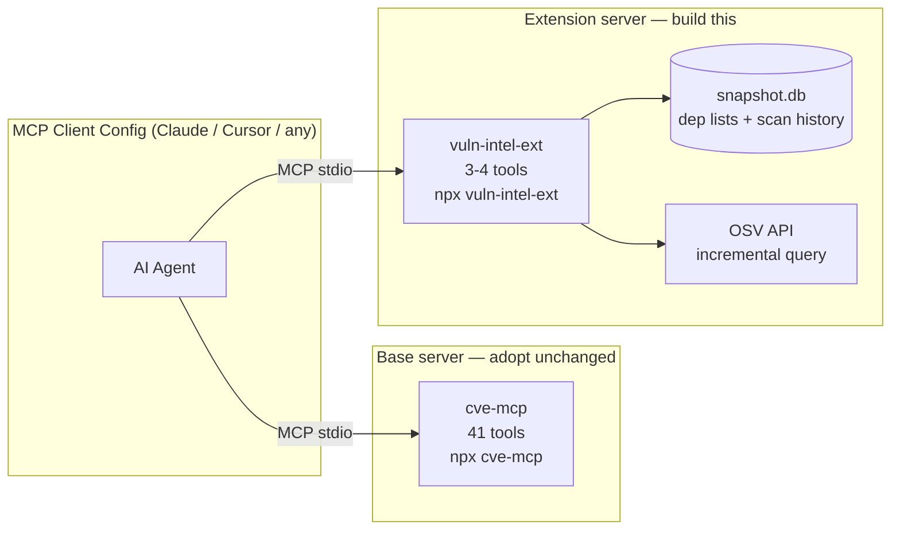

# Vulnerability Intelligence MCP — Design Doc & Implementation Plan

> **Status:** Design + scoped plan (pivoted — adopt existing tools, build thin extension)
> **Goal:** Give AI agents unified vulnerability intelligence by **adopting existing MCP servers** and building only the missing pieces on top.

---

## 1. Executive Summary — The Pivot

This design **started** as a from-scratch build of a universal vulnerability MCP server. Research revealed that **two mature open-source MCP servers already exist** that do ~95% of the job:

- **`cve-mcp`** (badchars/cve-mcp) — 41 tools, 11 data sources (NVD, EPSS, CISA KEV, GHSA, OSV, Shodan, VulnCheck, Vulners, Nuclei, Metasploit, CIRCL), risk scoring, bulk triage. `npx cve-mcp`. MIT license.
- **`supply-chain-mcp-server`** (badchars/supply-chain-mcp-server) — 7 composite tools / 90 techniques, 21 sources. Everything in cve-mcp plus package registries, deps.dev, OpenSSF Scorecard, Sigstore/Rekor, typosquatting detection, license compliance.

**We are pivoting from "build from scratch" to "adopt + extend."** The plan is now:

1. **Run `cve-mcp` (or `supply-chain-mcp-server`) unchanged** — get 41-90 vulnerability/supply-chain tools for free, zero maintenance burden on those tools.
2. **Build a thin sidecar extension MCP server** (`vuln-intel-ext`) that adds **only the 3-4 tools nobody has built yet** — primarily `diff_since` ("what new CVEs hit my dependencies since my last scan?") and optional WordPress + local-snapshot caching.
3. **Configure both servers** in the MCP client. The AI sees all tools from both.

This cuts the build from ~6 days / 12 tools / full ingest pipeline down to **~1-2 days / 3-4 tools / no ingest pipeline**.

---

## 2. What Already Exists (Don't Rebuild This)

### 2.1 `cve-mcp` — Vulnerability Intelligence (adopt this as the base)

| Property | Value |
|---|---|
| **Repo** | `github.com/badchars/cve-mcp` |
| **Install** | `npx cve-mcp` (zero config, 2 runtime deps) |
| **License** | MIT |
| **Tools** | 41 across 11 data sources |
| **Transport** | stdio |
| **Auth** | All optional (NVD_API_KEY, GITHUB_TOKEN, VULNCHECK_API_KEY, etc.) — works keyless |

**Tool categories already provided:**

| Category | Tools | What it does |
|---|---|---|
| NVD | `nvd_search`, `nvd_get`, `nvd_recent`, `cve_by_product` | CVE details, CVSS, CWE, CPE, keyword search |
| EPSS | `epss_score`, `epss_top` | Exploitation probability scoring |
| CISA KEV | `kev_check`, `kev_search`, `kev_recent` | Known-exploited-in-the-wild status |
| GHSA | `ghsa_search`, `ghsa_get` | GitHub advisory search + details |
| OSV | `osv_query`, `osv_get`, `osv_batch` | Package-level vuln lookup across 16+ ecosystems |
| Exploit | `exploit_search` | Public PoC exploit search (GitHub repos) |
| Shodan | `shodan_cve`, `shodan_product`, `shodan_ip_vulns` | Internet exposure + CVE lookup |
| VulnCheck | `vulncheck_kev`, `vulncheck_cpe`, `vulncheck_purl` | Extended KEV, CPE/PURL search |
| Vulners | `vulners_lookup`, `vulners_search` | 200+ source vuln search |
| Nuclei/MSF | `nuclei_check`, `msf_check` | Weaponization detection (exploit templates) |
| CIRCL | `circl_cve` | CVE enrichment (CAPEC, impact vectors) |
| AttackerKB | `attackerkb_assess` | Community exploitability assessments |
| ATT&CK | `cve_to_attack` | CWE → MITRE ATT&CK technique mapping |
| CWE | `cwe_lookup`, `cwe_get`, `cwe_hierarchy`, `cwe_top25` | Full CWE database + Top 25 |
| CVSS | `cvss_parse` | CVSS v3.1 + v4.0 vector parser/calculator |
| Meta | `cve_enrich`, `cve_prioritize`, `cve_trending`, `cve_compare`, `cve_report` | Full enrichment (8 sources parallel), risk ranking, trending, side-by-side compare, markdown report |

**Risk score formula (already implemented):**
```
Risk = CVSS × EPSS × KEV-multiplier(2 if in KEV) × Exploit-multiplier(1.5 if Nuclei/MSF exists)
```

**This covers our original design's tools 1-9** (lookup_cve, lookup_advisory, query_package, query_package_batch, search_cwe, search_keyword, search_severity, affected_versions, lookup_fix) — all already exist with different names and often richer data.

### 2.2 `supply-chain-mcp-server` — Full Supply Chain (optional upgrade)

If you want more than vulnerability intelligence — package provenance, OpenSSF Scorecards, typosquatting detection, license compliance, dependency graphs — `supply-chain-mcp-server` wraps all of cve-mcp's vuln sources **plus** 10 more supply-chain sources into 7 composite tools (90 techniques). Same author, same `npx` install pattern, MIT license.

**Recommendation:** Start with `cve-mcp` (simpler, focused). Upgrade to `supply-chain-mcp-server` if you need the broader supply-chain posture.

### 2.3 `@cyanheads/osv-advisory-mcp-server` — Pure OSV (alternative base)

If you want ONLY OSV (no NVD/EPSS/KEV enrichment) and prefer a more polished, well-tested server (Apache-2.0, 13 releases, has a public hosted instance), this is a clean 4-tool OSV wrapper. But it lacks the prioritization layer (EPSS, KEV) that makes `cve-mcp` more useful.

---

## 3. Gap Analysis — What Nobody Has Built Yet

Comparing our original 12-tool design against what `cve-mcp` already provides:

| Our original tool | Covered by cve-mcp? | Notes |
|---|---|---|
| `lookup_cve` | ✅ `nvd_get` + `cve_enrich` | Enrichment is richer than our design |
| `lookup_advisory` | ✅ `osv_get` + `ghsa_get` | |
| `query_package` | ✅ `osv_query` | |
| `query_package_batch` | ✅ `osv_batch` | |
| `search_cwe` | ✅ `nvd_search` (cweId) + `cwe_lookup` | |
| `search_keyword` | ✅ `nvd_search` + `vulners_search` | |
| `search_severity` | ✅ `nvd_search` (cvssV3Severity) | |
| `affected_versions` | ✅ `osv_get` + `nvd_get` | |
| `lookup_fix` | ✅ `osv_query` (returns fixedVersions) | |
| **`diff_since`** | ❌ **NOT COVERED** | The key gap — no "what's new for MY deps since MY last check" |
| `feed_status` | ❌ **NOT COVERED** | No freshness/staleness check |
| `refresh_feeds` | ⚠️ Partial | cve-mcp has TTL caching + `cve_list_sources`, but no explicit refresh trigger or local DB |

**Plus one ecosystem gap:**

| Gap | Covered? | Notes |
|---|---|---|
| **WordPress (WPScan)** | ❌ Not in cve-mcp, not in OSV | Only ecosystem OSV doesn't cover |

### The real gap: `diff_since`

This is the one tool that genuinely doesn't exist anywhere. An AI security auditor wants to say: *"My last scan was June 1st. Here are my 47 dependencies. What new CVEs appeared since then?"*

`cve-mcp` has `nvd_recent` (recently published CVEs globally) and `kev_recent` (recently added KEV entries), but **no tool that:**
1. Remembers YOUR specific dependency list
2. Remembers YOUR last-check timestamp
3. Returns only the delta — new vulns affecting YOUR packages since YOUR timestamp
4. Tracks modified (not just new) and withdrawn advisories

This is the highest-value thing to build. It's what turns "here are 500 recent CVEs" into "here are the 3 that affect your codebase."

---

## 4. Architecture — Sidecar Extension (Recommended)

### 4.1 Three Options Considered



| Option | Build effort | Maintenance | Coupling | Verdict |
|---|---|---|---|---|
| **A — Fork/merge** | Medium (merge 41 tools + add 3) | High (own all 44 tools, merge upstream) | Full | ❌ Not worth it for 3 tools |
| **B — MCP-to-MCP** | Medium (orchestrator + proxy logic) | Medium (proxy breaks if upstream tool schemas change) | High | ❌ Overkill — MCP clients already support multiple servers natively |
| **C — Sidecar** | **Low (build 3-4 tools only)** | **Low (maintain only your 3-4 tools)** | **None** | ✅ **Recommended** |

**Why sidecar wins:** MCP clients (Claude Desktop, Cursor, etc.) natively support multiple MCP servers in one config. The AI sees all tools from all servers — there's no UX downside to two servers vs one. You get all 41 cve-mcp tools + your 3-4 extension tools, and you only maintain the 3-4 you wrote.

**When MCP-to-MCP (Option B) would be worth it:** If you wanted to *transform* every cve-mcp call (e.g., add persistent caching to all 41 tools, or wrap them into fewer composite tools, or enforce auth/rate-limit policies centrally). For just *adding new tools alongside existing ones*, sidecar is strictly simpler.

### 4.2 Recommended Architecture



**MCP client config:**
```jsonc
{
  "mcpServers": {
    "cve-mcp": {
      "command": "npx",
      "args": ["cve-mcp"],
      "env": {
        "NVD_API_KEY": "...",        // optional, 50 vs 5 req/30s
        "GITHUB_TOKEN": "..."        // optional, 5000 vs 60 req/hr
      }
    },
    "vuln-intel-ext": {
      "command": "npx",
      "args": ["vuln-intel-ext"],
      "env": {
        "WPSCAN_TOKEN": "..."        // optional, for WordPress only
      }
    }
  }
}
```

The AI now has 44-45 tools total. It uses cve-mcp's tools for lookups/search/enrichment/prioritization, and uses `vuln-intel-ext`'s tools for diff-since-last-scan and WordPress.

---

## 5. The Extension Server — `vuln-intel-ext`

### 5.1 Technology

| Decision | Choice | Rationale |
|---|---|---|
| **Language** | TypeScript (Node.js/Bun) | Same as cve-mcp; `@modelcontextprotocol/sdk` + `zod`; matches the ecosystem |
| **MCP SDK** | TypeScript SDK, stable v1 | Production-ready, stdio transport |
| **Local store** | SQLite (`better-sqlite3`) | Stores dependency lists + scan history + last-check timestamps for `diff_since`. Tiny DB (~KB, not GB — we're NOT mirroring the full vuln DB) |
| **Transport** | stdio | Local agent integration |

### 5.2 Extension Tools (the only things to build)

#### Tool 1: `diff_since` — The key new tool

```typescript
input: {
  since: z.string(),                         // ISO 8601 timestamp of last scan
  packages: z.array(z.object({
    name: z.string(),
    version: z.string(),
    ecosystem: z.string().optional()         // npm, PyPI, Go, etc.
  })).optional(),                            // if omitted: uses last saved dep list
  severity: z.enum(["low","medium","high","critical"]).optional()
}
output: {
  since: string,
  scannedAt: string,
  packagesChecked: number,
  newVulnerabilities: VulnerabilitySummary[],     // published since timestamp
  modifiedVulnerabilities: VulnerabilitySummary[], // existed before but changed since
  withdrawnAdvisories: string[],                   // IDs that were withdrawn
  summary: { newCount, modifiedCount, withdrawnCount, worstSeverity }
}
```

**How it works (lightweight approach — no full DB mirror needed):**

1. **Resolve the dependency list:** If `packages` is provided, use it (and save it as the latest snapshot). If omitted, load the last-saved snapshot from SQLite.
2. **Query OSV for each package** via `POST https://api.osv.dev/v1/querybatch` (batch endpoint — one call for up to 1000 packages, no rate limit).
3. **Filter by timestamp:** For each returned vulnerability, check `published` and `modified` fields:
   - `published > since` → `newVulnerabilities`
   - `published <= since AND modified > since` → `modifiedVulnerabilities`
   - Check OSV's `withdrawn` field → `withdrawnAdvisories`
4. **Save the scan record:** Store `{ scannedAt, packageCount, vulnIds }` in SQLite so the next `diff_since` without explicit `since` defaults to this scan's timestamp.
5. **Return structured delta** — the AI gets only what changed, not the full re-scan.

**Why this works without a full local DB:** OSV's API has no rate limits and returns `published`/`modified`/`withdrawn` timestamps on every record. We query live, filter by date client-side, and cache only the dependency list + scan history (KB, not GB). This is far simpler than our original "download all of OSV to SQLite" design.

**Optional heavier mode (for offline/air-gapped):** If offline operation is needed, `diff_since` can instead read from a local OSV snapshot (downloaded via `modified_id.csv` incremental files — see Appendix B). But for most teams, the live-query approach is simpler and sufficient.

#### Tool 2: `save_dependency_snapshot` — Register your dependencies

```typescript
input: {
  packages: z.array(z.object({
    name: z.string(),
    version: z.string(),
    ecosystem: z.string().optional()
  })),
  label: z.string().optional()               // "production", "staging", etc.
}
output: {
  snapshotId: string,
  savedAt: string,
  packageCount: number,
  label: string | null
}
```

Saves a named dependency snapshot (e.g. parse a `package-lock.json` / `requirements.txt` / `go.sum` and store it). Then `diff_since` can reference it by label without re-passing the full list every time. Also enables "scan my production deps for new CVEs since last week" as a one-liner.

#### Tool 3: `feed_status` — Freshness check

```typescript
input: {}
output: {
  lastScan: { timestamp, packageCount, label } | null,
  sources: [
    { source: "osv", reachable: boolean, latencyMs: number },
    { source: "nvd", reachable: boolean, latencyMs: number }   // probed via cve-mcp's nvd_recent
  ],
  warnings: string[]                         // e.g. "No scan in 30 days"
}
```

Pings the upstream APIs to confirm reachability, reports when the last `diff_since` scan ran, and warns if it's been too long. The AI calls this before an audit to know if data is fresh.

#### Tool 4 (optional): `wp_scan` — WordPress vulnerability lookup

```typescript
input: {
  type: z.enum(["core", "plugin", "theme"]),
  name: z.string(),                          // "wordpress", "elementor", "twentytwentyfour"
  version: z.string().optional()
}
output: {
  vulnerabilities: Array<{ title, fixedIn, severity, references }>,
  cached: boolean                            // WPScan free tier = 25 req/day, so cache aggressively
}
```

WordPress is the one ecosystem OSV doesn't cover. This wraps the WPScan API (v3) with aggressive local caching (SQLite, 24h TTL) to stay within the 25 req/day free tier. Only build this if WordPress is in your scope.

### 5.3 SQLite Schema (tiny — just state, not a vuln mirror)

```sql
-- Dependency snapshots (the user's lockfile/dep list, saved for diff_since)
CREATE TABLE dependency_snapshots (
  id          INTEGER PRIMARY KEY AUTOINCREMENT,
  label       TEXT,                          -- "production", "staging", null
  packages_json TEXT NOT NULL,               -- [{name, version, ecosystem}]
  package_count INTEGER NOT NULL,
  saved_at    TEXT DEFAULT (datetime('now'))
);

-- Scan history (records each diff_since run)
CREATE TABLE scan_history (
  id          INTEGER PRIMARY KEY AUTOINCREMENT,
  snapshot_id INTEGER REFERENCES dependency_snapshots(id),
  since       TEXT NOT NULL,                 -- timestamp queried from
  scanned_at  TEXT DEFAULT (datetime('now')),
  new_count   INTEGER,
  modified_count INTEGER,
  withdrawn_count INTEGER,
  worst_severity TEXT,
  vulns_json  TEXT                           -- summary of findings (for audit trail)
);

-- WPScan cache (optional, only if WordPress tool is built)
CREATE TABLE wpscan_cache (
  type        TEXT NOT NULL,                 -- core | plugin | theme
  name        TEXT NOT NULL,
  version     TEXT,
  data_json   TEXT NOT NULL,
  cached_at   TEXT DEFAULT (datetime('now')),
  PRIMARY KEY (type, name, version)
);
```

**Total DB size:** Kilobytes. We're storing dep lists and scan metadata, not 300k vulnerability records.

---

## 6. Implementation Plan

> ~1-2 days total. The heavy lifting (41 tools, 11 data sources, risk scoring) is already done by `cve-mcp`.

### Phase 1: Adopt + Verify (0.5 day)
- Install `cve-mcp` via `npx cve-mcp`, configure in MCP client
- Optionally set `NVD_API_KEY` (free, [request here](https://nvd.nist.gov/developers/request-an-api-key)) and `GITHUB_TOKEN` for higher rate limits
- Test: ask the AI to query a known CVE, batch-scan a small dep list, prioritize by risk
- **Milestone:** AI has 41 vulnerability intelligence tools working

### Phase 2: Build `vuln-intel-ext` (1 day)
- Scaffold TypeScript project: `@modelcontextprotocol/sdk`, `zod`, `better-sqlite3`, `undici`
- Implement SQLite schema (3 tables above)
- Build `save_dependency_snapshot` tool
- Build `diff_since` tool (queries OSV batch API, filters by timestamp, saves scan record)
- Build `feed_status` tool
- Wire up MCP server (stdio), Zod input validation
- Test: save a dep snapshot, run diff_since, verify delta correctness against known recent CVEs
- **Milestone:** AI can track "what's new for my deps since my last scan"

### Phase 3 (optional): WordPress + Polish (0.5 day)
- Build `wp_scan` tool with WPScan API + SQLite cache (only if WordPress is in scope)
- Add `--list` CLI help, README, npm publish as `vuln-intel-ext`
- Configure both servers in the team's MCP client config
- **Milestone:** Full coverage including WordPress

### Phase 4 (optional): Offline mode (0.5 day)
- Add OSV incremental snapshot mode to `diff_since` (download `modified_id.csv`, cache changed records locally)
- Useful only for air-gapped/offline environments
- **Milestone:** Works without network at query time

**Total: 1.5-2.5 days** (vs. 6 days for the original from-scratch plan).

---

## 7. Team Workflow (how the AI uses both servers together)

```
Developer: "Audit my project's dependencies for new vulnerabilities since our last scan"

AI agent:
  1. calls vuln-intel-ext: feed_status          → "Last scan was 14 days ago, OSV reachable"
  2. calls vuln-intel-ext: diff_since            → (uses saved "production" dep snapshot)
       → "3 new CVEs since June 1st:
          CVE-2024-XXXX (npm:express, HIGH, EPSS 12%)
          CVE-2024-YYYY (PyPI:django, CRITICAL, EPSS 97%, in CISA KEV)
          CVE-2024-ZZZZ (npm:lodash, MEDIUM, modified — severity raised)"
  3. calls cve-mcp: cve_enrich {cveId: "CVE-2024-YYYY"}  → full enrichment
       → NVD: CVSS 9.8, CWE-89
       → EPSS: 97.2% exploitation probability
       → KEV: added 2024-06-10, deadline 2024-07-01
       → Nuclei: detection template exists
       → Metasploit: exploit module available
  4. calls cve-mcp: cve_prioritize {cves: ["CVE-2024-XXXX","CVE-2024-YYYY","CVE-2024-ZZZZ"]}
       → "#1: CVE-2024-YYYY (risk: 19.44) — patch immediately, actively exploited
          #2: CVE-2024-XXXX (risk: 4.2) — patch in next sprint
          #3: CVE-2024-ZZZZ (risk: 2.1) — monitor"
  5. calls cve-mcp: osv_query {package:"django", version:"3.2.0", ecosystem:"PyPI"}
       → "Fixed in 4.2+. Upgrade path: 3.2.0 → 4.2.0"
  6. → "Here's your delta audit. CVE-2024-YYYY is critical — it's in CISA KEV with
       a working Metasploit module. Upgrade django to 4.2+ immediately. The other
       two are lower risk."
```

The two servers compose naturally: `vuln-intel-ext` handles **what changed for your specific deps** (stateful, personalized), `cve-mcp` handles **deep enrichment and prioritization** of those findings (stateless, universal).

---

## 8. Risk Assessment

| Risk | Mitigation |
|---|---|
| **cve-mcp is a small project (16 stars)** | It's MIT licensed and has only 2 dependencies. If it's abandoned, you can fork it at that point — but you're not coupling to its internals (sidecar = no coupling). You could also swap to `@cyanheads/osv-advisory-mcp-server` as the base. |
| **cve-mcp makes live API calls (no local DB)** | OSV has no rate limits. NVD with an API key = 50 req/30s. For most teams this is fine. The offline mode (Phase 4) is available if needed. |
| **`diff_since` depends on OSV's `published`/`modified` timestamps being accurate** | OSV is well-maintained by Google/OpenSSF. We can cross-check against NVD's `lastModStartDate` for high-confidence deltas. |
| **Two servers in config = slightly more setup** | One extra block in the MCP client JSON. The AI sees all tools transparently — no UX downside. |
| **WPScan 25 req/day limit** | Aggressive SQLite caching (24h TTL). Only the first lookup per plugin/theme per day hits the API. |

---

## 9. Recommendation Summary

1. **Adopt `cve-mcp`** as the base vulnerability intelligence server — 41 tools, 11 sources, risk scoring, zero build. `npx cve-mcp`.
2. **Build `vuln-intel-ext`** — a thin sidecar MCP server with 3-4 tools that fill the only real gap: `diff_since` (delta scanning for your dependencies), `save_dependency_snapshot`, `feed_status`, and optionally `wp_scan`.
3. **Configure both** in your MCP client. The AI uses them together seamlessly.
4. **Skip the from-scratch build.** The original 12-tool / full-ingest-pipeline / SQLite-vuln-mirror design is unnecessary — it reinvents what's already shipped and maintained by others.

**Build effort: ~1.5 days** for the extension server. Everything else is free.

---

## Appendix A — Feed Research (Reference)

Retained from the original research for context. These feeds are what `cve-mcp` already integrates — documented here so you understand what's under the hood.

### OSV.dev — The backbone (used by cve-mcp's `osv_*` tools)
- **API:** `POST https://api.osv.dev/v1/query`, `/v1/querybatch`, `GET /v1/vulns/{id}`
- **Rate limits:** None
- **Coverage:** 30+ ecosystems (npm, PyPI, Go, Rust, RubyGems, Maven, NuGet, Packagist, Debian, Alpine, Ubuntu, Linux kernel, Android, Hex, Pub, Swift, Haskell, R, and more)
- **Already aggregates:** NVD CVEs (converted) + GitHub Advisory Database + PyPA + RustSec + Go vuln DB + Ruby Advisory DB + many more
- **Bulk dump:** `https://storage.googleapis.com/osv-vulnerabilities/all.zip`
- **Incremental:** `https://storage.googleapis.com/osv-vulnerabilities/modified_id.csv` (reverse-chronological — stream until last-seen timestamp)
- **Does NOT include:** EPSS scores, CISA KEV status, vulnerable functions (reliably) — these are why cve-mcp layers NVD/EPSS/KEV on top

### NVD — Enrichment (used by cve-mcp's `nvd_*` tools)
- **API:** `https://services.nvd.nist.gov/rest/json/cves/2.0`
- **Rate limits:** 5 req/30s without key, 50 req/30s with free key
- **Unique value:** CVSS v2/v3/v4, CWE, CPE configurations, CISA KEV flag, references with tags

### GHSA — Enrichment (used by cve-mcp's `ghsa_*` tools)
- **API:** `GET https://api.github.com/advisories` (REST)
- **Rate limits:** 60 req/hr unauthenticated, 5000 req/hr with token
- **Unique value:** EPSS scores, vulnerable functions, first_patched_version, malware advisories

### CISA KEV — Exploitation status (used by cve-mcp's `kev_*` tools)
- **URL:** `https://www.cisa.gov/sites/default/files/feeds/known_exploited_vulnerabilities.json`
- **Rate limits:** None (full catalog on every GET)
- **Unique value:** Exploited-in-the-wild flag + ransomware-use flag + required remediation action + due date

### WPScan — WordPress (NOT in cve-mcp — this is why we build `wp_scan`)
- **API:** `https://wpscan.com/api/v3/`
- **Rate limits:** Free Researcher tier = 25 req/day
- **Coverage:** WordPress core, plugins, themes — the one ecosystem OSV doesn't cover

---

## Appendix B — Optional: Offline `diff_since` via OSV Incremental Dumps

If air-gapped/offline operation is needed (Phase 4), `diff_since` can use OSV's incremental update mechanism instead of live API calls:

1. **Bootstrap:** Download `https://storage.googleapis.com/osv-vulnerabilities/all.zip` once (~hundreds of MB), parse into local SQLite.
2. **Incremental refresh:** Stream `https://storage.googleapis.com/osv-vulnerabilities/modified_id.csv`, stop at last-seen timestamp, download only changed `<ecosystem>/<id>.json` records, upsert.
3. **diff_since:** Query local SQLite `WHERE modified > :since` (no network needed).

This is heavier (~250MB local DB, background refresh job) but gives true offline operation. Only build this if your environment requires it — the live-query approach (Phase 2 default) is simpler and works for 99% of teams.
